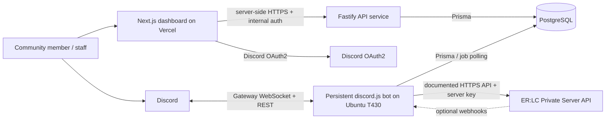

# BCRP Architecture

**Status:** Implemented foundation baseline  
**Date:** 2026-11-04

## System context

The bot, dashboard, and API are separate applications in one pnpm monorepo, as requested for the foundation implementation. The separately deployed API is a deliberate extension of the earlier plan, which initially favored Next.js server routes. The API starts on loopback by default and exposes only health plus an authenticated internal status route; it does not expose bot credentials or general bot-control operations.

## Applications and package responsibilities

| Unit                   | Responsibility                                                                                                                                  | Deployment                                                                                |
| ---------------------- | ----------------------------------------------------------------------------------------------------------------------------------------------- | ----------------------------------------------------------------------------------------- |
| `apps/bot`             | Discord Gateway connection, slash commands, component interactions, Discord event handlers, scheduled/retry work, execution of durable bot jobs | Persistent Node.js service on T430 (systemd/container optional)                           |
| `apps/dashboard`       | Next.js UI, Discord OAuth2 flow, secure session handling, guild-scoped server APIs, server-rendered reads and validated mutations               | Vercel                                                                                    |
| `apps/api`             | Internal Fastify HTTP service, health reporting, shared response envelope, authenticated internal routes, future server-side feature APIs       | Local Node process initially; production exposure requires a secured reachable deployment |
| `packages/database`    | Prisma schema/client, migrations, repository boundaries, transaction helpers                                                                    | Imported by server-side apps only                                                         |
| `packages/shared`      | Shared TypeScript types, validation schemas, API response envelopes, constants                                                                  | Build-time shared                                                                         |
| `packages/config`      | Zod schemas for environment and app configuration                                                                                               | Server-side shared                                                                        |
| `packages/logger`      | Structured logging interface, serializers, correlation metadata                                                                                 | Server-side shared                                                                        |
| `packages/permissions` | Discord, guild, staff, department, rank, and dashboard permission evaluation                                                                    | Server-side shared                                                                        |
| `packages/discord-ui`  | Components V2 builders, reusable coastal message layouts, safe component helpers                                                                | Bot                                                                                       |
| `packages/erlc`        | Typed HTTPS API client for documented ER:LC endpoints only                                                                                      | Server-side only                                                                          |

Shared packages must not cause bot-only credentials or Node modules to enter the browser bundle. Keep database, Discord bot, and ER:LC secret access in server-only code. Use explicit package exports and import boundaries.

## Runtime and communication

### Discord to bot

The bot maintains the Gateway WebSocket and uses Discord REST through discord.js. Gateway events and interactions are handled by modular command/event/component handlers. Enable only the intents required by shipped features; message content and other privileged intents require explicit consideration and possibly approval. Discord permission checks are performed both in the command execution path and in domain/application policies where relevant.

### Dashboard to API and database

The browser talks only to Next.js server code over HTTPS. In local development, the dashboard server can call the API at `API_URL`; internal calls authenticate with `API_AUTH_SECRET`. The API validates request payloads with Zod, applies domain permission policy, performs short database transactions, and records audit events as feature routes are added. The browser never receives the API secret, database URL, Discord bot token, ER:LC key, or OAuth client secret. The current foundation does not yet perform dashboard/API feature calls.

### Dashboard to bot

Do not expose a general-purpose public bot-control endpoint. For a dashboard action requiring live Discord work, the API transaction writes a durable job/outbox record to PostgreSQL. The bot claims pending jobs with a lease, validates guild/actor/action scope again, executes idempotently where possible, then records success or a classified retryable/permanent failure. The dashboard reads job status for user feedback. This provides durability when the bot restarts and avoids coupling a Vercel request to a bot process's availability.

Initially the bot can poll the job table at a modest interval, with bounded batch size and lease expiry. Adopt PostgreSQL notifications or a dedicated broker only if polling overhead or latency becomes material. Ensure only one active consumer claims each job and use unique idempotency keys for side effects.

### ER:LC integration

Use an adapter that calls only the official documented API. The owner confirms the ER:LC API pack is purchased. Official docs identify `GET https://api.erlc.gg/v2/server`, a `server-key` header, query switches for optional response sections, and links to the v2 API reference and event webhooks. This foundation client implements only the documented server-information route. Validate remote responses, set timeouts, handle rate limits and outages, redact keys, and surface unsupported capabilities as unavailable. Treat external API data as untrusted. No undocumented endpoints or commands are to be guessed.

## Data ownership and model direction

PostgreSQL is the durable source of truth for BCRP configuration and operational records. Discord and ER:LC remain authoritative for their own state. Store external IDs and observed snapshots where needed; reconcile rather than assume a local write succeeded remotely.

Initial logical entities (final schema belongs to implementation planning):

- `UserIdentity` / Discord user ID and dashboard session linkage.
- `GuildInstallation` and `GuildConfiguration`.
- `GuildAccessGrant` or role-policy configuration.
- `AuditEvent` recording actor, guild, action, target, outcome, and relevant redacted metadata.
- `BotJob` / outbox with idempotency key, payload version, claim lease, attempts, state, and timestamps.
- Feature records such as moderation cases, staff records, tickets, and shifts introduced with their feature phase.
- Optional ER:LC server connection settings encrypted or otherwise secret-managed; never expose keys to clients/logs.

Use Discord snowflakes as strings in application code and database mappings to avoid precision loss. Store timestamps in UTC, display in the user's/guild's configured timezone, and define retention/deletion behavior before collecting message or staff records.

## Security boundaries

- OAuth `state`, secure HTTP-only same-site cookies, CSRF protection for mutations, safe redirect allowlists, and session rotation/expiry.
- OAuth scopes kept minimal; obtain guild data server-side and still enforce guild-specific authorization per request.
- Validate environment at process startup with Zod and fail closed for missing production secrets.
- Use least-privilege database roles/network access where practical; configure pooling for serverless dashboard invocations.
- Bot jobs are untrusted input even though they originate from our DB: validate payload versions and re-check actor permissions before executing.
- Sanitize user-generated text and constrain mentions/allowed mentions; rate-limit sensitive operations.
- Redact tokens, authorization headers, personal data, and API keys from logs and error reports.
- Keep an audit trail for privileged changes, with retention and access controls.

## Hosting topology and tradeoffs

### Recommended initial topology

- Vercel serves the dashboard and its bounded HTTPS server functions.
- Ubuntu T430 can run the persistent bot process, internal API service, and (if choosing the lowest cash-cost path) PostgreSQL.
- The dashboard should call the API from server-side code, never directly from browser code for secret-protected operations.
- The API binds to `127.0.0.1` by default. A Vercel deployment cannot reach a home loopback address; production dashboard/API communication needs a separately designed HTTPS endpoint or private network/tunnel, firewall policy, and server-side secret storage. Do not expose the internal API broadly as part of this local foundation phase.
- Firewall database access to the dashboard egress/network path available from the chosen provider; use TLS where supported and strong credentials. Confirm Vercel-to-home connectivity, dynamic IP, ISP/router rules, and attack surface before deployment. If secure reachability is impractical, use a hosted PostgreSQL service or move the DB to a reachable host, subject to current cost.
- Back up database off-host and periodically test restoration. A backup on the same T430 is not a disaster recovery plan.

This is a cost-conscious starting topology, not a high-availability design. If the server, power, or ISP connection fails, both bot and self-hosted database may be unavailable. Separate database hosting or a second bot host can be considered later.

### Why the bot does not run on Vercel

Discord Gateway is a persistent WebSocket connection with reconnect/session state. Vercel documents request duration limits for Functions and explicitly says Functions do not support acting as a WebSocket server. Even where long function durations are available, bounded invocation is not a dependable daemon lifecycle. Use Vercel for dashboard requests and deploy the bot to a persistent service host.

## Reliability and observability

- Bot: automatic restart, graceful shutdown, Gateway reconnect awareness, readiness reporting, bounded caches, and no duplicate scheduled workers.
- Jobs: lease/timeout, attempt cap, exponential backoff with jitter, dead-letter state, operator-visible failure, and replay controls guarded by authorization.
- HTTP clients: timeout, rate limit handling, bounded retries for safe requests, circuit-breaker behavior where appropriate.
- Database: migration discipline, connection limits, backups, restore drills, and monitoring of disk/connection saturation.
- Logs: structured JSON with timestamp, level, service, environment, correlation ID, guild ID where appropriate, action, and error classification; redact secrets and avoid unnecessary message content.
- Health: distinguish liveness from readiness; expose no secrets or sensitive configuration.

## Deployment and migration sequencing

1. Apply backward-compatible schema migrations before deploying code that depends on them.
2. Deploy dashboard and bot versions that can tolerate old/new schema during a transition.
3. Backfill data in bounded, restartable jobs if needed.
4. Remove deprecated columns only after all deployed consumers have moved.
5. Never edit an already-applied migration; add a new migration.

Vercel preview environments must use isolated databases/configuration. Production bot and dashboard must share the intended production data set only. Secrets are configured independently per deployment target.

## Limitations and assumptions

- The package names and initial schema are now implemented as a foundation; the schema still needs review as feature workflows are designed.
- Local API binding and internal authentication do not yet define a production networking/deployment solution.
- The owner confirms the ER:LC API pack is purchased; an actual server key is still needed for live API requests and has not been provided.
- Discord privileged intents and permissions are feature-dependent.
- Free-tier terms, limits, database provider reachability, and Vercel product capabilities can change; re-check before deployment.
- This design intentionally avoids claiming ER:LC functions beyond the current official API reference.

## References

- [Discord Components Overview](https://discord.com/developers/docs/components/overview)
- [Discord Message Resource](https://discord.com/developers/docs/resources/message)
- [Discord OAuth2](https://discord.com/developers/docs/topics/oauth2)
- [ER:LC Private Server API](https://apidocs.erlc.gg/)
- [Vercel Limits](https://vercel.com/docs/limits)
- [Vercel Function duration](https://vercel.com/docs/functions/configuring-functions/duration)
- [discord.js docs](https://discord.js.org/docs)
